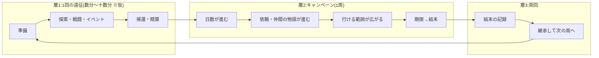
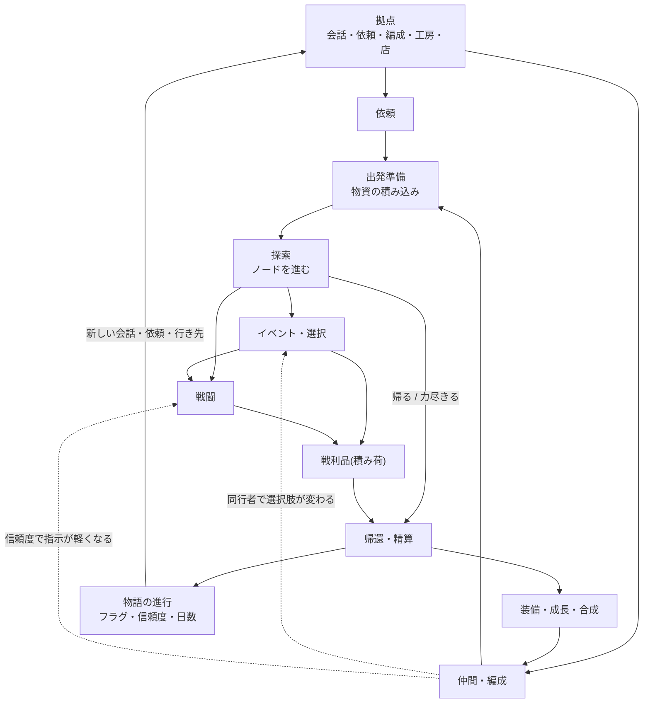
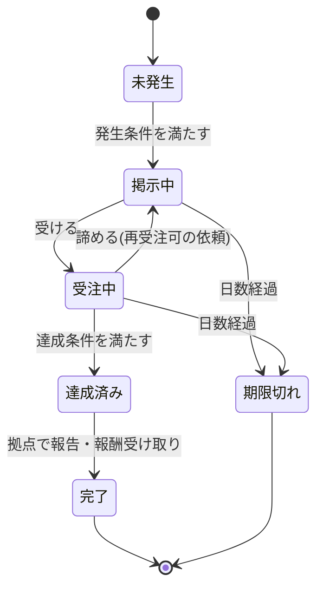
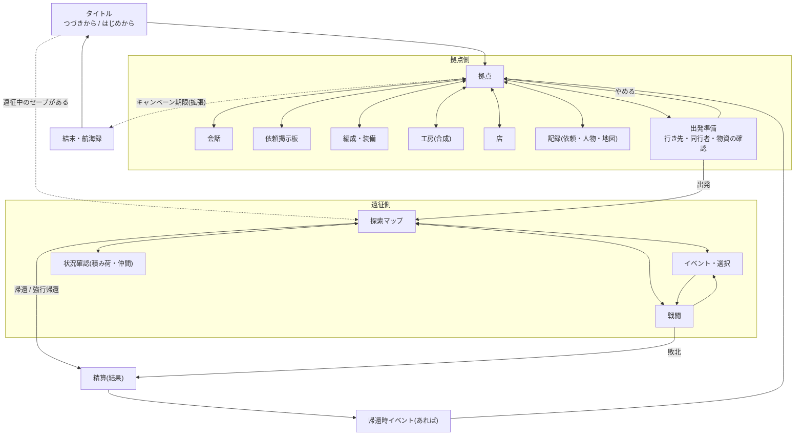
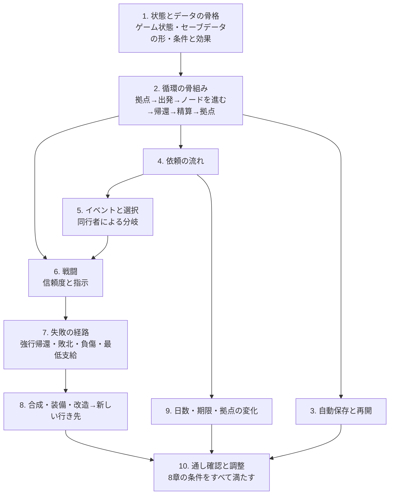

# 裏サクセス系オリジナル冒険ゲーム 大枠設計書

- 版: 第1稿(大枠)
- 仮題: 「霧海のサルベージャー」(舞台・名称はすべて仮。[9章](#9-判断をお願いしたい事項)参照)
- 目的: ゲームの全体像、機能のつながり、最初に動かす範囲、実装順を共有する

## 0. この文書の前提

**根拠の範囲。** 参考作品の理解は、依頼文に書かれた調査結果(代表場面の確認+攻略資料+インタビュー)だけを前提にしています。この設計のために動画やインタビューを改めて確認してはいません。原作の細部に関する記述は「調査でそう分かっている」範囲に留め、それ以上の断定はしていません。

**仮定した点。** 未決定事項は、互いに矛盾しない推奨案を一つ選んで埋めました。本文中の **【仮定】** がその印です。数値(日数、人数、件数など)はすべて「試遊で調整する仮置き」で、確定値ではありません。工数見積もりは根拠がないため書いていません。

**やらないと決めたこと。** ガチャ、スタミナ課金、デイリー任務、オンライン運営は前提にしません。買い切り型・オフラインで完結する一人用ゲームとして設計します 【仮定】。

**用語。**

| 用語 | 意味 |
|---|---|
| 拠点 | 準備・会話・依頼受注を行う町。遠征の出発点であり帰る場所 |
| 遠征 | 拠点を出てから帰るまでの1回の冒険 |
| キャンペーン | ゲーム開始から期限(結末)までの1周 |
| 周回 | キャンペーンを終えて、一部を引き継ぎ次の1周を始めること |
| ノード | 探索マップ上の1地点。線でつながり、1つずつ進む |
| マスターデータ | キャラ・敵・依頼などの「定義」。プレイ中に変化しない |
| セーブデータ | プレイヤーごとに変化する「現在の状態」 |
| フラグ | 「あの出来事が起きた」を記録する目印。物語の分岐条件に使う |

---

## 1. ゲームの中心となる体験

### 1.1 一文で言うと

> **「誰を連れて、どこまで踏み込み、いつ引き返すか」を決め、持ち帰ったものと一緒に仲間との物語が進むゲーム。**

プレイヤーは小さな探査艇の船長です。霧に沈んだ旧市街へ仲間と潜り、物資が尽きる前に成果を持ち帰ります 【仮定:舞台】。

### 1.2 プレイヤーが下す3つの判断

| 判断 | いつ | 何と何を天秤にかけるか |
|---|---|---|
| **誰と行くか**(編成) | 出発前 | 戦闘の安定 / 探索で開ける道 / 進めたい仲間の物語 |
| **どこまで行くか**(行程) | 遠征中、ノードごと | 奥の大きな成果 / 物資・HPの残り / 帰り道の費用 |
| **いつ帰るか**(撤退) | 遠征中、いつでも | いま確保できる戦利品 / もう一歩で届く目標 / 全滅の損失 |

この3つは別々の機能ではなく、一つの問いの3つの面です。「鍵開けができるトウカを連れて行けば近道が開くが、盾役がいないので深追いはできない」のように、編成が行程を変え、行程が撤退の判断を変えます。

### 1.3 獲得するものと、それが生む次の動機

| 獲得するもの | すぐの効果 | 次の行動への動機 |
|---|---|---|
| 素材・装備 | 合成で戦力が上がる | 「これがあれば、あの奥に行ける」 |
| 資金 | 物資・道具が買える | より長い遠征が組める |
| 情報(地図・噂) | 新しい行き先・依頼が出る | 「あの場所は何だったのか」 |
| 仲間の信頼 | 戦闘で指示が出しやすくなる | 「この人の話の続きが見たい」 |
| 物語の進行(フラグ) | 拠点の会話・依頼が変わる | 期限までに大目標へ届くか |

**動機は常に2本立てにします。** 「強くなったから先へ行ける」(成長の動機)と「続きが気になるから行く」(物語の動機)が、同じ遠征で同時に進むことが、裏サクセスらしさの中心だと考えます。

### 1.4 3つの時間の層



- **層1(遠征)** の楽しみは「あと一歩行くか」の緊張と、持ち帰れた安堵。
- **層2(キャンペーン)** の楽しみは、拠点が変わっていくこと。帰るたびに誰かの話が進み、依頼が増え、行ける場所が増える。日数には期限があり、全部はできないので「今回は誰の話を追うか」を選ぶことになる。
- **層3(周回)** の楽しみは、前回選ばなかった仲間・依頼・結末を見に行くこと。

層をつなぐのは **日数** です。遠征も拠点での休養も日数を使い、日数は依頼の期限とキャンペーンの期限の両方に効きます。

### 1.5 最終成果(野球選手育成に相当するもの)

原作の裏サクセスは「冒険の結果が、持ち帰れる成果物(選手)になる」点が周回の動機でした。本作では次の形を推奨します 【仮定】。

- キャンペーンの結末で **「航海録」** が1冊できる。到達した結末、各仲間の物語がどこまで進んだか、達成した依頼、見つけた場所が記録される。
- 航海録の内容に応じて **「継承枠」** が得られ、次の周に少数を持ち越す(例:仲間1人との縁=初期信頼度の上乗せ、設計図1枚、解禁済みの初期装備)。
- 持ち越しは「強さを積み上げる」より **「次の周の選択肢を増やす」** ことを主眼にする。強さの持ち越しを大きくすると、1.2の判断が作業になるため。

これは企画の方向で大きく変わる部分なので、9章の判断事項に挙げます。

---

## 2. 「正統進化」として残す核と、改善する部分

### 2.1 残す核

| 核 | 参考元(調査より) | 本作での形 |
|---|---|---|
| 拠点→遠征→帰還→強化の循環 | 4作共通 | そのまま骨格にする |
| 潜り続けるか帰るかの判断 | 10 | 物資と「帰路コスト」で常に問う |
| 仲間が戦力であり物語の当事者 | 12・13 | 同行者で探索の選択肢と依頼の展開が変わる |
| 信頼度が戦闘の指示に効く | 12 | 指示の消費が信頼度で軽くなる |
| 自動で進み、要所で介入する戦闘 | 13 | 片手操作に合うので採用 |
| 素材収集と装備合成 | 12 | 「次に行きたい場所」の理由として採用 |
| 全体は緩く、個別依頼に期限 | 13 | 緊張を局所に置く |
| 日数・資源・経路の結びつき | 9 | 日数を全層の共通通貨にする |
| 全部は見られない→周回 | 4作共通 | 期限と仲間の選択で作る |

### 2.2 改善する部分

| 原作系の負担(一般に想定されるもの) | 改善 |
|---|---|
| 発生条件が見えず、攻略情報が前提になりがち | **手がかりを出す。** 条件そのものは隠しても、「トウカが何か言いたそうだ」「この扉は機械に詳しい者なら…」のように、次に試すことが分かる表示をする |
| 取り返しのつかない失敗でやり直しになる | **失敗は損失であって詰みではない。** 敗北・期限切れ・資金切れのすべてに復帰経路を用意する(5.7節) |
| 帰れるかどうかが計算しにくい | **帰路コストを常時表示。** 「いま帰ると物資がいくつ必要か」を画面に出す |
| 資源の種類が多く管理が煩雑 | **資源を絞る。** 遠征中に見るのは物資・HP・気力の3つ(3.5節) |
| 携帯機前提の長い1プレイ | **どこで閉じても続きから。** 区切りごとの自動保存(5.6節) |
| 操作が細かい | **片手・タップ中心。** 戦闘は自動進行+介入、探索はノード選択 |

「分かりにくさを消す」と「発見の楽しみを消す」は別です。**何をすればよいかは分かるが、何が起きるかは行ってみないと分からない**、という線引きにします。

---

## 3. 必要な機能と相互関係

### 3.1 全体の関係図



点線が「裏サクセスらしいつながり」です。ここが切れると、ただの探索ゲームと会話ゲームの寄せ集めになります。

### 3.2 採用・統合・後回しの判断

| 原作系の要素 | 判断 | 理由(このゲームの遊びに照らして) |
|---|---|---|
| 拠点・依頼・仲間編成・探索・戦闘・合成 | **採用** | 中心の循環そのもの |
| 仲間の信頼度 | **採用** | 仲間を「戦力かつ人物」にする要の数値 |
| 同行者による依頼展開の変化 | **採用** | 「誰と行くか」に物語上の意味を与える |
| 燃料・車体HP・食料など複数の乗り物資源 | **統合→「物資」1種** | 判断は「まだ行けるか」の1点。種類を増やしても問いは増えず、管理だけが増える |
| HPとSP | **採用(HP・気力)** | 個人の消耗が「誰を前に出すか」の判断になる |
| 船・乗り物の改造で範囲拡大 | **段階採用** | 最初の範囲では「改造1つで新エリア1つ」だけ入れ、循環が閉じることを確かめる。本格的な改造ツリーは拡張 |
| 複数拠点・航海・交易 | **後回し** | 拠点1つで循環が成立してから。交易は「資金を得る手段」が依頼と競合するので、入れるなら役割分担を決めてから |
| 乗り物を直接操作する戦闘 | **後回し(不採用寄り)** | 別ジャンルの操作系が1本増える。中心の3判断に寄与しにくい |
| 仲間の雇用費 | **後回し** | 「信頼度が高いと安い」は面白いが、資金切れ時の復帰設計を複雑にする。まず信頼度→戦闘・イベントの効果だけで成立させる |
| 帰還でレベルが戻りスキルが残る方式 | **後回し** | 周回・継承の方式(9章)と強く絡むため、決定後に検討。最初は恒久成長のみ |
| キャンペーン期限と結末 | **段階採用** | 最初の範囲では日数経過と個別期限まで。結末と周回は拡張の最初に入れる |

### 3.3 拠点

- **操作:** 人物に話しかける/掲示板で依頼を見る・受ける/編成する/工房で合成・装備する/店で物資・道具を買う/休養して日数を進める/出発する。
- **変化する状態:** 受注中の依頼、編成、所持品、資金、日数、会話で立つフラグ・信頼度。
- **つながり:** 帰還のたびに、フラグ・日数・信頼度から「新しい会話」「新しい依頼」が再計算される。拠点は**変化を観察する場所**。話せる相手に印(「!」など)を付け、変化を見落とさせない。

### 3.4 仲間・編成

- **操作:** 主人公+同行者を選ぶ(【仮定】同行2人)。装備を付け替える。
- 仲間が持つもの:

| 要素 | 役割 |
|---|---|
| 戦闘の役割・技 | 戦闘での強み(盾役、回復、火力など) |
| 探索特技 | ノードやイベントで選択肢を増やす(鍵開け、採集、危険察知など) |
| 信頼度 | 戦闘の指示コスト、連携技の解禁、個別イベントの段階、結末 |
| 個別の物語 | 段階式のイベント。条件は「信頼度+同行+特定の場所や依頼」の組み合わせ |
| 状態 | 健康/負傷(能力が下がるが出撃はできる。休養か治療で回復) |

- **変化する状態:** レベル・習得技、装備、信頼度、物語段階、負傷。
- **つながり:** 探索特技→イベントの選択肢。信頼度→戦闘の指示。個別の物語→新しい依頼・装備・行き先。**「この人を連れて行く理由」が戦力・探索・物語の3方向から生まれる**ようにする。

### 3.5 資源管理

| 資源 | 範囲 | 減る場面 | 増える場面 | 尽きたとき |
|---|---|---|---|---|
| 日数 | キャンペーン | 遠征、休養、治療 | (増えない) | 依頼は期限切れ、全体は結末へ |
| 資金 | キャンペーン | 物資・道具・治療 | 依頼報酬、戦利品の売却 | 無料の最低支給で出発はできる(5.7) |
| 物資 | 遠征中・全員共通 | ノードを進む、休憩、一部の選択肢 | 出発時の積み込み、まれに現地で拾う | 強行帰還(5.7) |
| HP | 遠征中・個人 | 戦闘、罠 | 休憩、回復技、道具 | 戦闘不能。全員なら敗北 |
| 気力 | 遠征中・個人 | 技の使用 | 休憩、道具 | 技が使えない(通常攻撃は可) |
| 号令 | 戦闘中・全員共通 | プレイヤーの指示 | 時間で回復 | 指示できず自動進行のみ |
| 積載枠 | 遠征中 | 戦利品を拾う | 捨てる | 拾う/捨てるの選択 |

「物資」は原作系の燃料・食料・TSなどを一つにまとめたものです。**物資が「あと何歩進めるか」と「帰れるか」の両方を表す**ことで、行程と撤退の判断を一つの数字で読めるようにします。

### 3.6 依頼

- **操作:** 受ける/目的を確認する/達成して報告する/諦める。
- **種類:** 鍵依頼(物語を進める。期限なし、または再受注可)/個別依頼(仲間の物語。期限つきのものもある)/常設依頼(いつでも受けられる小さな稼ぎ。復帰の安全網)。
- **状態の流れ:**



- **つながり:** 「完了」と「期限切れ」の**両方**が、フラグを立てて次の会話・依頼を生む。期限切れは「何も起きない」ではなく「別の展開になる」。鍵依頼は期限切れにならないか、失敗時の代替ルートを必ず持つ。

### 3.7 移動・探索

- **形式:** 分岐するノードを1つずつ進む 【仮定】。自由に歩き回るマップより片手操作に向き、「次の一歩を進むか」の判断が毎回はっきり現れるため。
- **操作:** 次のノードを選ぶ/そのノードの行動を選ぶ/休憩する/帰還する。
- **ノードの種類:** 戦闘、採集、イベント、休憩地、関門(特技・道具・戦闘のいずれかで通る)、最深部。
- **変化する状態:** 現在地、物資、HP・気力、積み荷、発見済みノード、エリアの恒久的な変化(開けた近道など)。
- **帰路コスト:** いまの深さから帰るのに必要な物資を常に表示。足りなくなる一歩の前に警告する。
- **つながり:** 発見済みノードと開けた近道は遠征をまたいで残る。**撤退しても「次はここまで安く来られる」が残る**ので、撤退が前進になる。

### 3.8 戦闘

- **形式:** 自動で進み、プレイヤーが要所で指示する 【仮定】。
- **操作:** 指示(技の使用、狙う相手の指定、防御、道具)を号令を消費して出す。何もしなくても仲間は自分の方針で動く。逃走も選べる。
- **信頼度との関係:** 信頼度が高い仲間ほど指示の号令消費が軽い。さらに高いと連携技が使える。
- **変化する状態:** HP・気力、号令、敵の状態、戦闘後の経験値・戦利品。
- **つながり:** 戦闘前のイベント選択が戦闘条件を変える(奇襲、敵の数、回避)。戦闘での消耗が「まだ進むか」の判断材料になる。
- **留意:** 自動進行は「見ているだけ」になりやすい。指示が戦況を変えたと分かる場面(大技の予兆を防ぐ、など)を敵の設計に必ず入れる。ここは試作で手触りを確かめる必要があり、9章の判断事項にも挙げます。

### 3.9 戦利品

- **二段階で持つ:** 遠征中は **積み荷**(まだ自分のものではない)。帰還して初めて **倉庫**(確保済み)に入る。
- **つながり:** この区別が撤退判断の重みを作る。積み荷が増えるほど「帰りたい」、目標が近いほど「進みたい」。
- 依頼の目的品は「重要品」として扱い、売却・廃棄・喪失の対象外にする(5.7)。

### 3.10 装備・成長

- **操作:** 素材と資金で合成する/装備する/(拡張)探査艇を改造する。
- **成長の3系統:**
  - レベル(戦闘経験で上がる基礎能力)
  - 装備(素材から作る。素材の出どころが「次に行く場所」を決める)
  - 信頼度と技(仲間の物語と結びつく)
- **つながり:** レシピに必要な素材の産地を表示し、「欲しい装備→行き先」の線を見えるようにする。

### 3.11 会話・選択・イベント

- **発生する場所:** 拠点(人物との会話)、探索中のノード、戦闘の前後、帰還時。
- **仕組み:** すべて同じ「条件」と「効果」の語彙で書く(5.3節)。条件=フラグ、信頼度、同行者、所持品、日数、依頼状態。効果=フラグを立てる、信頼度の増減、アイテム・資金の増減、依頼の発生・進行、戦闘の開始、ノードの開通。
- **選択肢の出し方:** 条件を満たさない選択肢は、理由の手がかりを添えて薄く表示する(例:「こじ開ける ― 機械に詳しい仲間がいれば」)。
- **つながり:** ここが全機能の接着剤。イベントが探索・戦闘・報酬を変え、探索・戦闘の結果がイベントの条件になる。

### 3.12 帰還・失敗

| 終わり方 | きっかけ | 結果 |
|---|---|---|
| 帰還 | プレイヤーが帰還を選び、物資が帰路コスト以上 | 積み荷をすべて確保 |
| 強行帰還 | 帰還を選んだが物資が足りない/物資が尽きた | 不足分に応じて積み荷の一部を失う。同行者が疲労(負傷扱い) |
| 敗北 | 全員戦闘不能 | 救助される。積み荷の一部を失う。全員負傷。日数を余分に消費 |

どの終わり方でも**同じ精算処理**を通り、必ず拠点へ戻ります。どの場合も残るもの:経験値、発見済みノード、開けた近道、立ったフラグ、信頼度の変化。依頼の目的品は敗北時「現地に置き去り」になり、次の遠征で同じ地点から再回収できます。

---

## 4. 画面と画面遷移

**画面の向き:** 縦持ち・片手操作を推奨 【仮定】。下半分に操作、上半分に状況、という配置。



各画面の役割:

| 画面 | 見るもの | できること | 出口 |
|---|---|---|---|
| タイトル | セーブの有無 | 再開、新規 | 拠点、または遠征中の続き |
| 拠点 | 日数、資金、話せる相手の印、受注中の依頼 | 各施設へ、休養、出発 | 各施設、出発準備 |
| 会話 | 台詞、選択肢 | 選ぶ | 拠点(効果を適用して戻る) |
| 依頼掲示板 | 依頼の一覧、期限、報酬、目的地 | 受ける、諦める、報告 | 拠点 |
| 編成・装備 | 仲間の能力・特技・信頼度・状態 | 同行者選択、装備変更 | 拠点 |
| 工房 | レシピ、必要素材と産地、所持数 | 合成 | 拠点 |
| 店 | 物資・道具、資金 | 買う、売る | 拠点 |
| 出発準備 | 行き先、同行者、物資量、受注中依頼のうち行き先に関係するもの | 物資の積み込み、出発 | 探索、拠点 |
| 探索マップ | ノード、現在地、物資、帰路コスト、全員のHP・気力、積み荷 | 進む、行動、休憩、帰還 | イベント、戦闘、精算 |
| イベント | 文章、選択肢(不可のものは手がかりつき) | 選ぶ | 探索、戦闘 |
| 戦闘 | 敵味方の状態、号令、行動の予兆 | 指示、道具、逃走 | 探索/イベント、精算(敗北) |
| 精算 | 終わり方、確保/喪失した品、経験値、信頼度の変化、依頼の進み、経過日数 | 確認 | 帰還時イベント、拠点 |

**行き止まりの画面を作らない規則:** すべての画面は、拠点または探索マップへ戻る経路を持つ。精算は必ず拠点へ抜ける。

---

## 5. 動くゲームとして成立するための土台

### 5.1 ゲーム状態(いま何をしている最中か)

ゲーム全体は、常に次のどれか一つの状態にあります。

```
拠点 → 出発準備 → 遠征中 ─┬─ 探索(ノード選択待ち)
                           ├─ イベント中
                           └─ 戦闘中
       遠征中 → 精算 → 拠点
       拠点 → 結末 → (周回) → 拠点    ※拡張
```

この「いまの状態」をセーブデータに書くことが、中断・再開の基礎になります。

### 5.2 進行条件(何をすれば先へ進むか)

| 進むもの | 条件 | 止まらないための保証 |
|---|---|---|
| 遠征の開始 | 行き先が1つ以上解禁、主人公が出撃可能 | 最初のエリアは常に解禁。主人公は負傷していても出撃可 |
| 新しい依頼の発生 | フラグ・日数・信頼度・完了済み依頼 | 常設依頼は無条件で常にある |
| 新しい行き先の解禁 | 鍵依頼の完了、改造、情報の入手 | 鍵依頼は期限切れにならない |
| 仲間の物語の段階 | 信頼度+同行+場所など | 条件の手がかりを拠点の会話で出す |
| 日数の経過 | 遠征、休養、治療 | 日数を進める手段(休養)は常にある |
| キャンペーンの終了(拡張) | 日数が期限に達する/最終依頼の完了 | どの達成度でも何らかの結末がある |

### 5.3 必要なデータ

**マスターデータ(定義。変化しない)**

| データ | 主な内容 |
|---|---|
| キャラクター | 能力の基礎値、役割、技、探索特技、個別物語の段階定義 |
| 技・特技 | 効果、気力消費、使用条件 |
| 敵・敵編成 | 能力、行動、落とす物 |
| アイテム | 種別(素材/装備/道具/重要品)、効果、売値 |
| レシピ | 必要素材・資金、できる物、解禁条件 |
| エリア・ノード | ノードの種類、つながり、物資消費、深さ、中身(戦闘/採集/イベントの参照) |
| 依頼 | 発生条件、目的、期限、報酬、完了時・失敗時の効果 |
| イベント・会話 | 発生条件、文章、選択肢、選択肢ごとの条件と効果 |
| 店の品揃え | 品目、価格、解禁条件 |

**共通の「条件」と「効果」。** 依頼・イベント・会話・ノード・レシピ解禁のすべてが、同じ書き方の条件と効果を使います。これが設計上もっとも重要な土台です。機能ごとに別々の仕組みを作ると「依頼を達成したのに会話が変わらない」といった断線が起きます。一つの語彙に揃えれば、どの機能からどの機能へも線を引けます。

- 条件の例: フラグの有無/信頼度が一定以上/特定の仲間が同行中/特定の特技を持つ仲間がいる/アイテム所持/日数/依頼の状態/ノード到達済み
- 効果の例: フラグを立てる/信頼度の増減/アイテム・資金・物資の増減/HP・気力の増減/依頼の発生・進行・完了・失敗/戦闘開始/ノード・エリアの開通/仲間の加入/日数経過

**セーブデータ(現在の状態。変化する)**

| 区分 | 内容 |
|---|---|
| 管理情報 | データの版番号、いまのゲーム状態(5.1) |
| キャンペーン | 日数、資金、倉庫、フラグ一覧、依頼ごとの状態、解禁済みエリア・レシピ、発見済みノード、エリアの恒久変化 |
| 仲間 | 加入済みか、レベル・経験値、装備、信頼度、物語段階、負傷 |
| 遠征(遠征中のみ存在) | エリア、同行者、現在地、物資、各人のHP・気力、積み荷、今回の遠征で通ったノード、進行中のイベント/戦闘の開始時点の情報、乱数の種 |
| 周回(拡張) | 航海録、継承済み要素、周回数 |

### 5.4 報酬と消費の処理

規則は3つです。

1. **消費はその場で、確保は帰還時に。** 物資・HP・気力・道具の消費は起きた時点で確定。戦利品は積み荷に入り、精算で初めて倉庫に入る。
2. **精算は一か所で一度だけ。** 帰還・強行帰還・敗北のどれも同じ精算処理を通る。精算は次の順で一括して行う。
   1. 終わり方に応じて積み荷の喪失分を決める
   2. 残りの積み荷を倉庫へ移す
   3. 経験値・レベルアップを反映する
   4. 同行者の信頼度変化・負傷を反映する
   5. 日数を進める
   6. 依頼の達成条件・期限を判定し直す
   7. 遠征データを消し、状態を「拠点」にして保存する
3. **二重取りと取りこぼしを防ぐ。** 精算の途中でアプリが閉じられても、再開時に「精算をもう一度最初からやり直せる」か「精算済みとして拠点から始まる」かのどちらかになるようにする(精算前の状態を保存→精算結果をまとめて一度に保存)。

依頼の報酬も同じ考え方で、「報告」操作の一度だけ、報酬の付与・依頼状態の更新・後続フラグの設定をまとめて行います。

### 5.5 日数の処理

- 遠征1回の所要日数は、行き先までの距離+終わり方(敗北は救助のぶん長い)で決まる。
- 日数が進んだら、必ず同じ「日送り処理」を通す: 依頼の期限判定 → 負傷の回復 → 日数条件のイベント・依頼発生 →(拡張)キャンペーン期限の判定。
- 期限つき依頼を受けているときは、出発準備の画面で「この遠征から帰ると残り何日か」を表示する。

### 5.6 セーブ・ロードと、スマホでの中断・再開

スマホでは、電話・通知・電池切れ・片手間のプレイで、いつアプリが閉じられてもおかしくありません。「セーブする」操作をプレイヤーに求めず、**区切りごとの自動保存**を基本にします。

| 場面 | 保存する時点 | 再開したとき |
|---|---|---|
| 拠点 | 操作(購入、合成、編成、受注、会話の完了)のたび | 拠点から |
| 探索 | ノードの処理が終わるたび | 探索マップの同じ地点から |
| イベント | イベントの開始時点と、完了して効果を適用した時点 | 途中で閉じた場合はそのイベントの最初から(効果はまだ適用されていない) |
| 戦闘 | 戦闘の開始時点 | その戦闘の最初から。乱数の種も保存しておき、やり直しても同じ展開になりやすくして、閉じて結果を選び直す遊び方を抑える |
| 精算 | 精算結果を一括で | 拠点から、または精算の最初から |

- **原則:「効果の適用」と「保存」を同じ区切りで行う。** 効果を適用したのに保存していない、保存したのに効果が半分、という状態を作らない。
- **データの版番号**を持ち、更新でデータ構造が変わったときに古いセーブを変換できるようにする。
- **セーブは1キャンペーン1本の自動保存**を基本とし 【仮定】、やり直し用の手動セーブ枠は周回方式が決まってから検討する(期限と選択の重みが変わるため)。
- 保存に失敗した場合は直前の正常なデータを残す(書きかけで上書きしない)。

### 5.7 失敗後の復帰(詰みの防止)

「これが起きたら進めなくなる」状況を列挙し、それぞれに出口を用意します。

| 詰みうる状況 | 出口 |
|---|---|
| 資金が尽き、物資が買えない | 出発時に少量の物資を無料で支給する(浅い場所なら往復できる量)。常設依頼で稼ぎ直せる |
| 物資が遠征中に尽きた | 強行帰還。積み荷の一部を失うが必ず帰れる |
| 全滅した | 救助されて拠点へ。損失はあるが続行できる |
| 仲間が全員負傷 | 負傷は能力低下であり出撃禁止ではない。休養(日数)か治療(資金)で治る |
| 依頼の目的品を失った・売った | 重要品は売却・廃棄・喪失の対象外。敗北時は現地に残り再回収できる |
| 鍵依頼に失敗した | 鍵依頼は期限なし、または再受注可。あるいは失敗時の代替ルートを定義する |
| 個別依頼が期限切れ | 物語は別の展開へ進む(その周では見られない場面ができる=周回の動機) |
| 必要な素材が手に入らない | 鍵となる装備の素材は、解禁済みエリアで必ず入手できる場所を持つ |
| 敵が強すぎて進めない | 常設依頼と浅い遠征で成長・資金・素材を得られる。撤退しても経験値は残る |
| 積載枠がいっぱい | 拾うときに「何を捨てるか」を選べる |
| キャンペーン期限に達した(拡張) | 達成度に応じた結末→航海録→周回 |
| セーブデータが壊れた | 直前の正常データから再開 |

**設計上の確認方法:** マスターデータに対して「鍵依頼の連鎖が、開始状態から必ず最後まで辿れるか」「すべての依頼が完了・失敗のどちらでも後続を持つか」を機械的に点検できるようにします(7章の実装順に含めます)。

---

## 6. 最初に一巡遊べる範囲

### 6.1 最初の範囲と拡張の切り分け

**最初の範囲の目的は「循環が閉じ、仲間と物語が探索に効いていること」を確かめることです。** 量ではなく、線がすべてつながっていることを優先します。分量はすべて仮置きです。

| 項目 | 最初の範囲 | その後の拡張 |
|---|---|---|
| 拠点 | 1つ(会話・掲示板・編成・工房・店・休養) | 拠点の発展、複数拠点 |
| 仲間 | 3人(うち2人を同行)。それぞれ役割・探索特技・個別イベント1〜2段階 | 人数、加入イベント、物語の後半段階、連携技 |
| エリア | 1つ+改造で開く2つ目の入口部分 | エリア追加、乗り物改造ツリー |
| 依頼 | 鍵依頼1、期限つき依頼1、仲間の個別依頼1、常設依頼1 | 依頼の連鎖、章構成 |
| 戦闘 | 自動進行+指示、敵数種、ボス1体 | 敵の種類、状態異常、連携技 |
| 装備・合成 | レシピ数個、改造1つ | 装備の系統、強化 |
| イベント | 同行者で分岐する探索イベント複数、拠点会話の変化 | 分量の拡大 |
| 日数 | 経過、個別期限、負傷回復 | キャンペーン期限、結末 |
| 失敗 | 帰還・強行帰還・敗北の3つすべて | ― |
| 保存 | 自動保存、遠征中の再開 | 版の変換、周回データ |
| 周回 | なし(範囲の終わりで「ここまで」と表示) | 結末、航海録、継承 |
| 演出 | 文章と簡素な表示 | 絵、音、演出 |

最初の範囲に**含めないと確かめられないもの**(削らない):

- 同行者によって探索の選択肢が変わる場面
- 信頼度が戦闘の指示に効くこと
- 依頼の完了と期限切れの両方が、次の会話・依頼を変えること
- 撤退・敗北から立て直して同じ依頼を達成できること
- 合成した装備または改造が、新しい行き先を開くこと

### 6.2 仮の登場人物と依頼(例示用)

すべて説明のための仮置きです。

- **トウカ**(整備士): 探索特技「鍵開け・機械」。戦闘は補助寄り。
- **ガラン**(元衛兵): 探索特技「危険察知」。戦闘は盾役。
- **ユズ**(薬師見習い): 探索特技「採集・薬品鑑定」。戦闘は回復。
- **依頼人:** 診療所の医師(拠点の人物)。

**依頼「診療所の薬棚」**

- 発生: 最初の鍵依頼を終えた後、診療所で医師と話すと掲示される。
- 内容: 旧病院跡の最深部から「保存薬品箱」(重要品)を持ち帰る。
- 期限: 掲示から一定日数 【仮】。
- 報酬: 資金、治療費の割引、素材。

### 6.3 通し例:成功した場合

| 段階 | プレイヤーの操作 | 起きること・変わる状態 |
|---|---|---|
| **受注** | 診療所で医師と話す→掲示板で依頼を受ける | 依頼が「受注中」に。期限の残り日数が表示される。会話でユズが「薬のことなら分かるかも」と言い、同行の手がかりになる |
| **準備** | 編成でトウカとユズを選ぶ。店で物資を買い足す。出発準備で確認 | 資金が減り、積み込む物資が増える。準備画面に「帰ると残り何日」「この依頼の目的地はここ」と出る。盾役のガランを外したので戦闘は不安、という自覚が生まれる |
| **探索(序盤)** | ノードを進む。採集ノードで採集 | 物資が減る。ユズの「採集」で素材が多く取れ、積み荷に入る。帰路コストが深さとともに上がる |
| **イベント(関門)** | 錆びた防火扉の前。選択肢:①トウカに開けさせる ②物資を使ってこじ開ける ③遠回りする | トウカがいるので①が選べる。物資を使わず通過し、扉の奥の保管室で追加の戦利品を得る。「近道が開通」(恒久)。トウカの信頼度が上がり、彼女が扉の刻印に見覚えがあると漏らす(個別物語のフラグ) |
| **判断** | 最深部の手前。物資は帰路コスト+少し。HPは減っている。休憩するか、進むか、帰るか | 休憩を選ぶと物資を使ってHP・気力が回復。帰路コストぎりぎりになり、警告が出る。それでも進むことを選ぶ |
| **戦闘(ボス)** | 薬品保管室の番をする機械。自動で進む中、大技の予兆に合わせてユズに回復、トウカに「機械の弱点を突く」を指示 | 号令を消費。トウカは信頼度が上がっているので指示が軽い。勝利し、経験値と素材、「保存薬品箱」(重要品)を得る。依頼が「達成済み」に |
| **イベント(薬品鑑定)** | 棚に残った薬瓶。ユズがいるので「使える薬を見分ける」が選べる | 回復道具を積み荷に追加。ユズの信頼度が上がる |
| **帰還** | 帰還を選ぶ | 物資が帰路コスト以上あるので通常の帰還。精算へ |
| **精算** | 結果を確認 | 積み荷がすべて倉庫へ。経験値でレベルアップ。信頼度の変化が表示される。日数が進む |
| **報告** | 拠点で依頼を報告 | 報酬(資金・素材)を受け取る。依頼が「完了」に。治療費割引のフラグが立つ |
| **次の変化** | 拠点を回る | ①医師の会話が変わり、病院跡の地下について新しい依頼が掲示される ②トウカに「!」が付き、扉の刻印についての個別イベントが見られる→個別依頼が発生 ③工房で、ボスの素材を使う新レシピ(改造部品)が解禁され、作ると2つ目のエリアの入口が開く |

この1回で、依頼→編成→探索→イベント→戦闘→帰還→報酬→成長→新しい依頼・会話・行き先、のすべての線を通ります。

### 6.4 通し例:撤退した場合

防火扉の時点で、同行者がガランとユズ(トウカなし)だったとします。

| 段階 | 起きること |
|---|---|
| 関門 | ①は「機械に詳しい仲間がいれば」と手がかりつきで選べない。②物資を使ってこじ開ける、を選ぶ。通過できるが物資が大きく減り、音で敵が寄ってきて戦闘になる(ガランの「危険察知」で奇襲は避けられる) |
| 判断 | 最深部手前で、物資が帰路コストとほぼ同じ。進めばボス戦後に帰れなくなる。**帰還を選ぶ** |
| 精算 | 通常の帰還。ここまでの積み荷(素材)はすべて確保。経験値も入る。日数が進む。依頼は「受注中」のまま、期限が減る |
| 残るもの | こじ開けた扉は開いたまま(近道が恒久的に開通)。発見済みノードも残る |
| 次の行動 | 確保した素材を売る・合成する。次は近道のぶん物資に余裕ができる。拠点でトウカが「あの扉、私なら…」と話し、編成を変える動機になる。期限に間に合う範囲で再挑戦する |

撤退は「何も得られなかった」ではなく、**素材・経験値・近道・情報を持ち帰った前進**として扱われます。

### 6.5 通し例:敗北した場合

物資が足りないままボスに挑み、全員戦闘不能になったとします。

| 段階 | 起きること |
|---|---|
| 敗北 | 戦闘画面から精算へ。「町の救助艇に拾われた」という短い場面 |
| 精算 | 積み荷の素材を一部失う。同行者と主人公が負傷。日数が通常の帰還より余分に進む。経験値は残る。ボスに与えた変化は残らないが、開いた近道・発見済みノードは残る |
| 拠点 | 負傷は能力低下の状態で表示される。治療(資金)か休養(日数)で治せる。負傷のまま出撃もできる。資金がなければ無料支給の物資と常設依頼で立て直せる |
| 期限に間に合えば | 再挑戦して達成。6.3と同じ結果に合流する |
| 期限が切れたら | 依頼は「期限切れ」に。医師は別の手段で薬を調達するが、診療所の割引は得られず、医師の会話と後続依頼が別の内容に変わる。ユズの個別物語は別の入口から始まる。**物語は止まらず、違う形で進む** |

### 6.6 その後に拡張する範囲(順序つき)

1. **キャンペーン期限・結末・航海録・周回**: 層2と層3を閉じる。ここで初めて「1周」が成立する。
2. **依頼の連鎖と章構成、仲間の物語の後半**: 内容の厚み。
3. **エリア追加と乗り物改造**: 行動範囲の拡大。
4. **仲間の追加、連携技、(検討)雇用費**。
5. **複数拠点・移動・交易**: 採用する場合のみ。
6. **絵・音・演出、操作性の磨き込み**。

---

## 7. 実装順(依存関係を踏まえて)

技術の選定は遊びの確認より後でよい、という立場です。ただし順序に関わる要請が2つあります。**(a) ゲームの規則(状態と処理)を画面表示から切り離す**こと。(b) **内容をデータとして書き、規則の側を書き換えずに追加できる**こと。この2つがあれば、表示の技術を後から決めても、変えても、規則は残ります。



| 順 | 作るもの | この段階で確かめること | 先に必要なもの |
|---|---|---|---|
| 1 | ゲーム状態、セーブデータの形、条件と効果の仕組み、マスターデータの読み込み | 条件を判定し、効果を適用すると状態が変わる(画面なしで試せる) | ― |
| 2 | 循環の骨組み。戦闘とイベントは「勝った/何か拾った」の仮処理 | 拠点から出て、物資を使って進み、帰って、積み荷が倉庫に入り、また出発できる | 1 |
| 3 | 区切りごとの自動保存、タイトルからの再開 | 拠点・探索のどこで閉じても同じ状態から再開する。早い段階で入れるのは、後から足すと全機能の保存漏れを探すことになるため | 2 |
| 4 | 依頼の発生・受注・達成判定・報告・報酬 | 依頼を受けて目的を果たし、報告すると報酬が入り、次の依頼が出る | 2 |
| 5 | イベントと選択肢、同行者・特技・所持品による分岐、信頼度の変化 | 同行者を変えると選択肢と結果が変わる | 1, 4 |
| 6 | 戦闘(自動進行、指示、号令、信頼度による消費の差、逃走) | 指示で戦況が変わる。信頼度で指示の重さが変わる。**手触りの良し悪しをここで判断する** | 2, 5 |
| 7 | 強行帰還、敗北、負傷、治療・休養、無料支給、重要品の保護 | 5.7節の表を一つずつ再現し、すべて復帰できる | 6 |
| 8 | 合成、装備、改造、エリア解禁 | 持ち帰った素材で作った物が、新しい行き先を開く | 2, 7 |
| 9 | 日送り処理、依頼の期限切れと後続、拠点会話の変化と印 | 期限切れでも物語が別の形で進む | 4 |
| 10 | 6章の仮内容を入れて通し、数値を調整。データの整合点検(鍵依頼が必ず辿れるか等) | 8章の条件をすべて満たす | 全部 |

段階2の時点で「貧弱だが一巡する」ものができ、以後は常に一巡する状態を保ったまま厚くしていきます。画面を全部並べてから中身をつなぐ順序は取りません。

---

## 8. 大枠が成立したと判断する条件

すべて「プレイヤーがこう操作すると、こう観察できる」形で確認します。

### 循環がつながっている

1. 新規開始から、説明書きなしで、拠点→依頼受注→出発→探索→帰還→報告→次の依頼の受注まで到達できる。
2. 探索で拾った素材が、帰還後に倉庫に増えており、工房でその素材を使って装備を作れ、その装備を付けて次の遠征で数値や選択肢に違いが出る。
3. 作った改造部品によって、それまで選べなかった行き先が出発準備で選べるようになる。
4. 依頼を報告すると、拠点の人物の会話が変わり、新しい依頼が掲示板に出る。

### 仲間と物語が探索・戦闘に効いている

5. 同じ関門ノードに、同行者を変えて2回行くと、選べる選択肢と結果(消費する物資、得る戦利品、発生する戦闘)が異なる。
6. 選べない選択肢に手がかりが表示され、それを読んで編成を変えると選べるようになる。
7. 特定の仲間を連れて特定の場面を通ると、帰還後にその仲間の個別イベントが拠点で発生し、そこから新しい依頼が出る。
8. 信頼度の低い仲間と高い仲間で、同じ指示の号令消費が違うことが戦闘画面で分かる。
9. 戦闘で指示を一切出さない場合と、予兆に合わせて指示した場合とで、受ける被害に明らかな差が出る。

### 判断に重みがある

10. 探索中、いつでも「いま帰ると物資がいくつ必要か」が見え、足りなくなる一歩の前に警告が出る。
11. 同じ依頼に対し、「浅く行ってすぐ帰る」と「最深部まで行く」で、持ち帰れる物と危険が実際に違う。
12. 期限つき依頼を受けて出発準備を開くと、帰還後の残り日数が分かる。

### 失敗から復帰できる

13. 撤退すると、それまでの積み荷がすべて倉庫に入り、依頼は受注中のまま残り、次の遠征では開けた近道が使える。
14. わざと全滅すると、拠点に戻され、積み荷の一部が減り、仲間が負傷しているが、そのまま再出発でき、同じ依頼を達成できる。
15. 物資が帰路コストに足りない状態で帰還を選ぶと、積み荷の一部と引き換えに必ず拠点へ戻れる。
16. 資金を0にしても、無料支給の物資で出発でき、常設依頼で資金を得て立て直せる。
17. 依頼の目的品は、店で売れず、捨てられず、敗北しても次の遠征で取り戻せる。
18. 期限つき依頼をわざと期限切れにすると、依頼人の会話と後続の展開が変わり、鍵依頼は引き続き進められる。

### 中断と再開ができる

19. 探索中にアプリを強制終了して再起動すると、同じノード・同じ物資・同じHP・同じ積み荷で再開する。
20. 戦闘中に強制終了して再起動すると、その戦闘の最初から再開し、戦闘前の消耗や積み荷は保たれている。
21. 精算の表示中に強制終了して再起動しても、戦利品と報酬が二重に入らず、失われてもいない。
22. 拠点で購入・合成・編成をした直後に強制終了しても、その操作が残っている。

### 構造が閉じている

23. どの画面からも、数回の操作で拠点または探索マップへ戻れる。
24. マスターデータの点検で、鍵依頼の連鎖が開始状態から最後まで辿れ、すべての依頼が完了・期限切れのどちらでも進行不能にならないと確認できる。
25. 最初の範囲を一通り終えた後、「次は別の仲間を連れて行ってみたい」「あの選べなかった選択肢を試したい」という、やり残しが具体的に挙げられる(試遊者への聞き取りで確認)。

25番だけは観察ではなく感想ですが、裏サクセスらしさの成否はここに出るため、条件に含めます。

---

## 9. 判断をお願いしたい事項

推奨案で一通り組みましたが、次の4点は好みと企画の方向で設計が大きく変わります。それ以外(画面の向き、セーブ枠、資源の統合など)は、試作しながら直せる範囲と考えています。

| # | 判断事項 | この文書の推奨(仮定) | 別の方向と、変わる部分 |
|---|---|---|---|
| 1 | **舞台と雰囲気** | 霧に沈んだ旧市街へ探査艇で潜る。潜行(10的)と往来(13的)を両立しやすい | 宇宙、海、地下、現代の裏社会など。骨格は変わらないが、「物資」「乗り物」「拠点」の意味づけ、仲間の人物像、会話の調子がすべて変わる。原作らしい「軽さと不穏さの同居」をどの程度狙うかも含む |
| 2 | **最終成果と周回の方式** | 結末ごとに航海録ができ、少数の継承枠で次の周の選択肢を増やす | (a) 原作のように、別の遊び(育成や対戦など)に持ち込める成果物を作る→その「別の遊び」の設計が必要 (b) 周回なしの一本道の長編→期限を緩め、取り逃しを減らす設計に変える (c) 強さを大きく引き継ぐ→後半の難度設計が変わる |
| 3 | **期限の厳しさ** | 全体は緩く、個別依頼に期限。1周では全員の物語は見切れない程度 | 厳しくすると計画性と周回の動機が強まるが、取り逃しの不満と攻略情報への依存が増える。なくすと安心して遊べるが、「誰の話を追うか」の選択が弱まる |
| 4 | **戦闘の手触り** | 自動進行+指示(信頼度で指示が軽くなる) | 1手ずつ選ぶコマンド式にすると、戦術の密度は上がるが1回の遠征が長くなり、片手・短時間の遊び方から離れる。段階6の試作で実際に触って決めるのがよいと考えます |

**開発環境について。** 規則と表示を分け、内容をデータで書く、という2点(7章)を守れば、選定は段階2〜3の前後まで遅らせられます。判断材料は、開発する人数と経験、最終的に配信したい場所(アプリストアか、ブラウザか)、絵と演出の比重です。これらが分かった時点で候補を比較します。

---

## 10. 次の一歩

上の4点のうち、**1(舞台)と2(最終成果・周回)** の方向が決まれば、マスターデータの項目定義と、最初の範囲の内容(ノード構成、イベント文、依頼の連鎖)の具体化に進めます。3と4は、最初の範囲を作りながら試して決められます。
